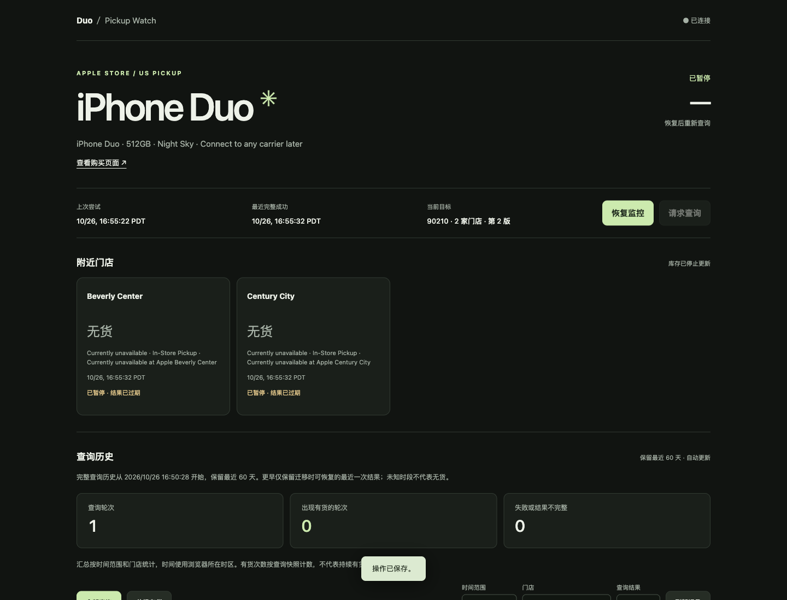

# iPhone Duo Pickup Monitor

[中文](README.md) | [English](README.en.md)

A Docker-hosted monitor for iPhone Duo pickup availability on the Apple US store. Choose a ZIP code, color, storage capacity, carrier, and nearby stores in the dashboard. When stock is available, receive a **Bark notification with a purchase link** or a **phone call through Grafana Cloud IRM**.

- Use any five-digit US ZIP code. Nearby stores come from Apple's current results.
- Star White / Night Sky; 256GB / 512GB / 1TB / 2TB; AT&T / T-Mobile / Verizon / Connect to any carrier later.
- A dedicated Chromium browser checks each round and verifies the product, ZIP code, and stores. Page changes and request failures produce an unknown result.
- Settings, pause state, and 60 days of per-store query history persist across restarts. History can be filtered for past availability.
- Bark and phone calls can be enabled independently. No Apple account is needed; follow the alert to purchase on Apple's website.

Supports iPhone Duo on the Apple **US store**, with product options checked against Apple's pages. Inventory reflects the query time; check Apple's page when purchasing.



The dashboard supports Chinese and English through the language selector in the header. The first visit follows your browser language; a manual choice is saved in that browser. Switching preserves unsaved settings and formats dates and numbers in the chosen language, using your browser's local time zone.

If the initial status request fails, the dashboard still reconnects automatically. No page reload is needed when the service recovers.

## Deploy with an AI agent (recommended for first-time users)

Download and extract the repository, or clone it with Git. Open the whole project directory in an AI agent that can read and write files and run terminal commands. The agent prepares the runtime, and the database is created on first startup. Give the agent this request:

```text
Read AGENTS.md and docs/agent-setup.en.md, and complete this project's first-time setup and deployment for me.
Check the environment, then ask together for any missing deployment host, US ZIP code, product options, store selection, and notification channels.
Configure, build, start, and verify the service, and prepare .env so I can enter credentials directly.
Test each notification channel I select once (the phone channel will place a real call).
After I confirm receipt on my phone, enable monitoring and wait for the first real inventory query to finish.
Give me the access address, current monitoring state, verification results, and instructions for pausing, updating, and backing up.
```

Follow the [AI agent setup and deployment guide](docs/agent-setup.en.md) for the complete procedure. The agent prepares Docker, handles local or remote deployment, and configures the product and stores. You handle account login, SMS verification, phone permissions, and receipt confirmation. Bark-only setups do not need Grafana.

## 1. Docker deployment

You need Docker Engine with Compose v2, or Docker Desktop, at least 2 GiB of available memory, and network access to Apple and your selected notification services. Git is used for cloning and updates; a ZIP download can be deployed without Git. The container runs Linux, and Linux x86_64 has been verified. ARM64 / Apple Silicon has not been verified. Keep the Chromium sandbox enabled and use the supplied container permissions.

```sh
git clone https://github.com/ChenshuXu/iphone-duo-monitor.git
cd iphone-duo-monitor
cp .env.example .env
# Edit .env and enter the notification credentials you need before starting.
docker compose up -d --build
docker compose ps
```

Fill in the channels you use in `.env`; leave the others empty. Replace these placeholders with your own values:

```dotenv
BARK_KEY='YOUR_BARK_DEVICE_KEY'
GRAFANA_IRM_WEBHOOK='https://oncall-prod-REGION.grafana.net/integrations/v1/YOUR_TOKEN/'
```

The first build downloads a large browser image. Once the service is healthy, open [http://localhost:8088](http://localhost:8088) on the deployment machine. The dashboard shows whether credentials are configured and provides switches and tests. There is no manual database setup, cookie transfer, or product-number editing. Compose injects `.env` into the container environment. After changing credentials, run `docker compose up -d` to recreate the container; `docker compose restart` retains the old values.

The default binding is `127.0.0.1`, and the service has no login. Use local access or an SSH tunnel to a server:

```sh
ssh -L 8088:127.0.0.1:8088 your-user@your-server
```

Then open [http://localhost:8088](http://localhost:8088) on your computer. Replace the SSH user and server with your own.

### LAN / VPN access

For direct access from your phone, set `.env` to the server's actual LAN address, for example:

```dotenv
PUBLIC_ORIGIN=http://192.168.10.20:8088
BIND_ADDRESS=192.168.10.20
PORT=8088
GRAFANA_IRM_HOST=
```

Replace the example address. After `docker compose up -d`, use that exact address in the browser. `localhost`, `127.0.0.1`, IP addresses, and hostnames are distinct. `PUBLIC_ORIGIN` has no path or trailing slash; update it whenever you change the public port.

Anyone who can reach this port can change settings, trigger notification tests, and view history and screenshots. Enter notification credentials in `.env` on the deployment machine. Use SSH or a private VPN for remote access. Public access requires an HTTPS reverse proxy with authentication and access control, and `PUBLIC_ORIGIN` must match the external HTTPS address.

## 2. Choose your product and stores

1. A new installation starts **paused**. In a fresh database, channels with supplied credentials default to enabled. Existing databases retain their saved switches across restarts.
2. In monitoring settings (监控设置), enter your US ZIP code and select the color, capacity, and carrier. Connect to any carrier later corresponds to Apple's option of the same name.
3. Click **Read nearby stores (读取附近门店)**. The container opens the selected Apple page, verifies the options, and submits the ZIP code. This usually takes tens of seconds and can take a few minutes on a slow connection.
4. Select the stores you want and click **Save settings (保存设置)**. The list contains nearby stores returned by Apple for that request.
5. Follow the [notification guide](docs/notifications.en.md) to finish `.env` and Grafana setup. Send a single test from the dashboard and confirm receipt on your phone.
6. Click **Resume monitoring (恢复监控)**. Automatic queries wait randomly after the previous round: 60.001 to 179.999 seconds normally, or 180.001 to 599.999 seconds after an error. **Request query (请求查询)** runs at the earliest allowed time: immediately if the minimum interval has elapsed, otherwise when the minimum wait or Apple rate limit ends. Clicking during a query does not start another one. Refreshing the page does not query Apple.

Before changing the ZIP code or product options, pause and wait for the current round to finish. Rediscover stores, select and save them, then resume. Previous stock becomes unknown immediately; an old round cannot notify for the new configuration. History keeps the product and ZIP code used in each round.

Store discovery cooldown starts when the request finishes: at least 60 seconds after success, or 180 seconds after failure, with any longer `Retry-After` honored. Keep the deadline across restarts. For Apple blocks, verification challenges, or unknown pages, inspect the collection diagnostics and resolve the issue.

## 3. Bark notifications and Grafana phone calls

See the [notification guide](docs/notifications.en.md) for setup, templates, verification, and troubleshooting:

- [Bark device key, permissions, configuration, and testing](docs/notifications.en.md#bark-push-notifications)
- [Grafana number verification, phone rules, escalation chain, Webhook templates, and routing](docs/notifications.en.md#grafana-cloud-irm-phone-calls)
- [Troubleshooting missing notifications](docs/notifications.en.md#troubleshooting)

Notification check times use UTC; the dashboard uses the browser's local time zone.

Bark uses the official `https://api.day.app/push` endpoint. Self-hosted Bark servers are not supported. Each round sends one ordinary `active` notification per store explicitly reporting stock. A fault notification is sent once after at least 3 failed rounds and 30 minutes without a complete success, followed by one recovery notification.

Each round combines available stores into a new phone alert group. Continuing stock produces further calls. **Pause monitoring after buying.** During setup, answer the test call to verify the full notification path.

Failed notification requests put Bark into an independent 10-second cooldown (180.001 to 599.999 seconds for HTTP 429) and the phone channel into an independent cooldown of 180.001 to 599.999 seconds, or until the actual `Retry-After` deadline if longer. Even waits over ten minutes remain finite. Cooldowns survive restarts and apply to manual tests. Inventory queries and the other channel continue. During Bark cooldown, the remaining stores in that round are not sent. When a stock alert fails and the cooldown is 10 seconds or less, the round retries up to twice after each cooldown. Once the next round starts, old stock is not replayed; notifications use the fresh result.

Tests, stock alerts, and phone group cleanup run in sequence within each channel. Queued notifications recheck switches, cooldowns, and the configuration version before sending. Pausing, disabling calls, or stopping the service waits for an in-flight phone alert to finish before resolving its group. A failed alert retains its group and actual cooldown deadline.

After receiving the test call, keep monitoring paused and click **Clear phone alert groups (清理电话分组)**. This resolves old alert groups without placing another call or resuming inventory queries. If cooling down, wait until the displayed deadline. Legacy permanent phone pauses have a separate recovery message: confirm that Grafana's rate limit has cleared, then use cleanup while keeping the original Webhook until it succeeds. See the notification guide for details.

Manage notification credentials in `.env`.

For older installations that stored credentials in the database, back up first and securely move the original Bark key / Webhook into `.env`. Missing credentials cause migration to stop, preserving the original configuration and history. Successful startup removes the old `secrets` state field and uses the environment values. Before replacing or clearing a Webhook, resolve pending phone groups using the original address; otherwise startup with the new configuration is rejected.

## 4. History, updates, and backups

Query history (查询历史) uses the browser's time zone. Filter by the last 24 hours, 7 / 30 / 60 days, store, or outcome; each page contains 50 rounds. Every monitoring query saves its product, ZIP code, and per-store result. A service exit during a query leaves an interrupted record. Store discovery is for setup and is excluded from monitoring history. Availability counts measure query snapshots, not the duration of continuous stock.

Keep deployment parameters, the Bark key, and the full Grafana Webhook in `.env`. Product settings, ZIP code, stores, switches, and Bark group / TTL are saved to SQLite through the dashboard. Credentials are read only from the process environment and are not written into new database state records. Git and the Docker build context ignore `.env`, `data/`, databases, and private `local/` operations notes. Keep `.env.example` generic. Existing installations using a bind directory can set `DATA_VOLUME=./data`; the default uses a named volume.

The container mounts all data at `/data`: SQLite settings and history, an anonymous browser profile, and a limited set of diagnostic screenshots. `.env` determines its storage source:

| `DATA_VOLUME` | Storage location | `docker compose down` | `docker compose down -v` |
| --- | --- | --- | --- |
| Unset or `monitor-data` | Compose named volume, usually `<project-name>_monitor-data` | Keeps data | **Deletes the named volume and all its data** |
| `./data` or another bind directory | `data/` in the deployment directory, or the specified directory | Keeps directory and data | **Still keeps directory and data** |

Changing `DATA_VOLUME` only switches the mount source; it does not migrate existing data. `.env` contains plaintext credentials, should have permissions `0600`, and needs a separate secure backup. Old databases and backups may retain historical credentials. Full `docker compose config` / `docker inspect` output can expose environment variables. Routine updates keep data:

```sh
git pull --ff-only
docker compose up -d --build
docker compose logs --tail 50 monitor
```

A paused instance stays paused after restart. An active instance resumes on the normal schedule. The latest 200 events, 20 failure screenshots, and 60 days of query history are retained automatically; history pruning also runs while paused.

Pause and stop the service before backing up so SQLite finishes writing. This command supports named volumes and bind directories and creates `monitor-backup.tar.gz` in the current directory. It uses a temporary file with permissions `0600` and replaces the old backup only after a successful, nonempty export:

```sh
sh <<'SH'
set -eu
umask 077
docker compose stop monitor
backup_tmp=$(mktemp ./monitor-backup.XXXXXX)
trap 'rm -f "$backup_tmp"' EXIT
if docker compose run --rm --no-deps --user 0 --entrypoint tar monitor -C /data -czf - . > "$backup_tmp" && test -s "$backup_tmp"; then
  mv -f "$backup_tmp" monitor-backup.tar.gz
  docker compose start monitor
else
  echo 'Backup failed; the previous backup is unchanged and the service remains stopped. Check the cause.' >&2
  exit 1
fi
SH
```

On failure, the command exits nonzero and retains the previous backup. Fix the problem and retry. To start the service before retrying, run `docker compose start monitor`. Back up `.env` separately; it is not part of the data archive.

Before restoring, prepare `.env`, choose a **new, empty named volume or bind directory**, and stop the target service. Run `docker compose create` to create a named volume, or prepare an empty bind directory, then run:

```sh
docker compose run --rm --no-deps --user 0 --entrypoint tar -T monitor -C /data -xzf - < monitor-backup.tar.gz
docker compose up -d
```

Restoring brings back the saved pause state and dashboard settings. Credentials come from the restore machine's `.env`; a volume backup alone cannot restore them. Restore into empty storage rather than a running database. Databases from the older family edition outside this repository have a different product schema and need a separate migration.

Check the storage type before deleting data: `down -v` leaves bind-directory databases, history, and browser profiles intact and does not delete `.env`. When investigating browser profile locks, first confirm that the old container and browser have stopped; retain the existing cookies and profile locks.

Execution steps and network errors (执行步骤与网络异常) in query history retain step timings and Apple HTTP / network errors for 60 days. URLs exclude user information, query strings, and fragments. Headers, cookies, and response bodies are not recorded. Diagnostics missing from old records cannot be reconstructed. Pickup queries handle both supported page entry layouts, ZIP prefill, and option recovery after product-page redirects, while verifying color, capacity, carrier, product number, and ZIP code.

## 5. Development and verification

With Node.js 24+:

```sh
npm ci
npm run format:check
npm test
```

Use `npm run format` to format JavaScript, HTML, and CSS consistently. Use one statement per line, separate variable declarations, brace conditionals and loops, and separate logical steps with blank lines.

Chromium regression tests explicitly skip outside a Linux Docker environment. To run the checks used for deployment:

```sh
docker compose build
docker run --rm --init --user 1000:1000 --shm-size=512m \
  --cap-drop=ALL --cap-add=SYS_CHROOT \
  --security-opt no-new-privileges:true \
  --security-opt seccomp=./seccomp_profile.json \
  -v "$PWD/test:/app/test:ro" -v "$PWD/README.md:/app/README.md:ro" \
  iphone-duo-monitor:local npm test
STORAGE_TEST_IMAGE=iphone-duo-monitor:local sh test/storage.test.sh
```

Backup regression tests execute the documented command with simulated Docker failures to verify backup preservation and permissions. Storage tests create isolated temporary named volumes and bind directories, check retention after `down` / `down -v`, and clean up. Automated tests use simulated Apple pages and notification senders. See the [verification record](docs/verification.en.md).

Non-root Chromium uses the supplied seccomp profile, `SYS_CHROOT`, and shared memory. CDP listens only on loopback inside the container. If host policy blocks user namespaces or the browser sandbox, fix host compatibility while retaining the sandbox.

Server, Docker, and network outage alerts require a separate external heartbeat service.

## License

[MIT](LICENSE). Third-party attribution is in [THIRD_PARTY_NOTICES.md](THIRD_PARTY_NOTICES.md). The browser base image, Playwright, and external services retain their own licenses and terms.
