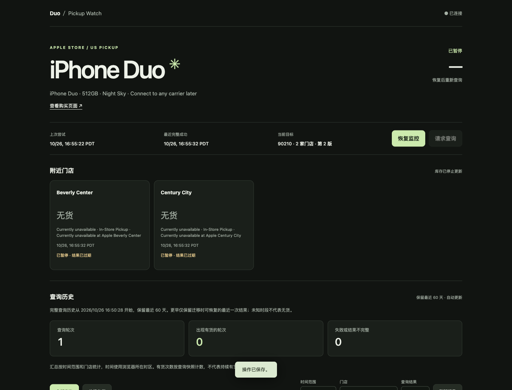

# iPhone Duo Pickup Monitor

用 Docker 自托管的 Apple 美国官网 iPhone Duo 取货监控。网页选择邮编、颜色、容量、运营商及附近门店，有货时通过 **Bark 推送购买链接**，或通过 **Grafana Cloud IRM 拨打电话**。

- 自选五位美国 ZIP code；从 Apple 当次页面结果读取附近门店，不内置个人门店列表。
- Star White / Night Sky；256GB / 512GB / 1TB / 2TB；AT&T / T-Mobile / Verizon / 稍后连接运营商。
- 独立 Chromium 浏览器逐轮查询，核对商品、ZIP 和门店。页面变化或请求失败显示“未知”，不会当作无货。
- 持久化配置、暂停状态及最近 60 天逐店查询历史，可筛选曾经有货的记录。
- Bark 与电话可独立开关；无需 Apple 账号，不下单、不处理付款。

目前只支持 Apple **美国商店**与 iPhone Duo。选项来自 Apple 页面核对；Apple 后续更改商品、页面或接口时可能需要适配。本项目与 Apple、Bark、Grafana 无关联，库存是查询时快照，不保证能买到。



## 1. Docker 部署

需要 Git、Docker Engine + Compose v2（或 Docker Desktop）、至少 2 GiB 可用内存，以及可访问 Apple、Bark 和 Grafana 的网络。容器内为 Linux，已验证 Linux x86_64；ARM64 / Apple Silicon 尚未验证。不要使用 `--privileged` 或关闭 Chromium 沙箱。

```sh
git clone https://github.com/ChenshuXu/iphone-duo-monitor.git
cd iphone-duo-monitor
cp .env.example .env
docker compose up -d --build
docker compose ps
```

首次构建会下载较大的浏览器镜像。服务健康后在部署机器打开 **http://localhost:8088**。无需手工建数据库、复制 Cookie、填写你的通知密钥或编辑商品编号。

默认绑定 `127.0.0.1`，无登录。请保留本机访问，或通过 SSH 转发访问服务器：

```sh
ssh -L 8088:127.0.0.1:8088 your-user@your-server
```

然后在自己的电脑打开 http://localhost:8088。SSH 用户和服务器地址换成自己的。

### 局域网 / VPN 访问

如需要直接从手机访问，把 `.env` 改为实际服务器的局域网地址，例如：

```dotenv
PUBLIC_ORIGIN=http://192.168.10.20:8088
BIND_ADDRESS=192.168.10.20
PORT=8088
GRAFANA_IRM_HOST=
```

这是示例地址，必须替换为自己的。运行 `docker compose up -d` 后，浏览器也必须用完全相同的地址访问；`localhost`、`127.0.0.1`、IP 和主机名不能混用。`PUBLIC_ORIGIN` 不带路径或尾斜线，改端口时也要同步修改它。

**所有能访问此端口的人都能修改设置、调用通知测试、查看历史和截图。** Host / Origin 检查不能代替登录。HTTP 下填写的密钥会经过明文连接；不要公网端口转发。远程访问优先用 SSH / 私有 VPN；公开访问需要自己配置 HTTPS、认证和访问控制的反向代理，并让 `PUBLIC_ORIGIN` 与外部 HTTPS 地址一致。本项目不附带公网网关。

## 2. 选择自己的商品和门店

1. 首次安装是**暂停**状态，通知默认关闭。
2. 在“监控设置”填写自己的美国邮编，选择颜色、容量和运营商。“Connect to any carrier later”对应 Apple 的稍后连接运营商选项，并不代替购买资格判断。
3. 点击“读取附近门店”。容器会打开所选 Apple 商品页、核对页面选择并提交邮编，通常需要数十秒，网络慢时可能需要几分钟。
4. 勾选想去的门店，点击“保存设置”。目录只包含本轮 Apple 返回的附近门店；不提供任意远距离全美扫描。
5. 按[通知配置指南](docs/notifications.md)设置 Bark 和 / 或电话，保存后发送单次测试，确认手机实际收到。
6. 点击“恢复监控”。正常等待为随机 60.001–179.999 秒，异常等待为 180.001–599.999 秒；下一轮在上轮完成后安排。网页上的“请求查询”保留等待，不会绕过限流。

更换邮编、颜色、容量或运营商时，先暂停并等待当前轮结束，再重新读取门店、选择并保存，最后恢复。旧库存立即变为未知，旧轮次不用于新配置通知，旧查询保留其当时的商品和 ZIP。刷新网页不会额外查询 Apple。

门店读取成功后至少冷却 60 秒，失败后至少 180 秒，并尊重更长的 `Retry-After`。不要通过重启或并发部署绕过限制。Apple 拦截、验证码或未知页面需要自行检查，程序不会绕过验证。

## 3. Bark 与 Grafana 电话

完整步骤、模板、验收和排查见 **[通知配置指南](docs/notifications.md)**：

- [Bark：获取设备 key、权限、保存与测试](docs/notifications.md#bark-推送)
- [Grafana：号码验证、电话规则、通知链、Webhook 模板与路由](docs/notifications.md#grafana-cloud-irm-电话)
- [测试收不到通知时如何排查](docs/notifications.md#故障排查)

通知正文的检查时间使用 UTC，网页使用浏览器本地时区。

Bark 当前使用官方 `https://api.day.app/push`，不支持自建 Bark 服务器。每轮每家明确有货门店推送一条普通 `active` 通知；故障持续至少 3 轮且 30 分钟无完整成功后通知一次，恢复后再通知一次。

电话每轮汇总有货门店并创建新分组；接听或确认这一通不会停止下一轮。**买到后请在本项目中暂停监控**。电话 HTTP 接受成功不等于已经拨通；号码、手机拦截与服务侧限制仍会影响送达。

## 4. 历史、更新与备份

“查询历史”按浏览器所在时区显示，支持最近 24 小时、7 / 30 / 60 天、门店及结果筛选，每页 50 轮。每次实际监控查询都保存当轮商品、ZIP 和逐店结果；查询中退出会留下“中断”。门店发现只用于配置，不计入监控历史。有货次数表示查询快照数，不表示连续有货时长。

数据存于 Compose 命名卷 `monitor-data`，包括 SQLite、通知凭据、匿名浏览器资料和有限的诊断截图。凭据不回显到网页接口，但数据库中未额外加密；备份也要当作敏感文件保护。普通更新不会清空卷：

```sh
git pull --ff-only
docker compose up -d --build
docker compose logs --tail 50 monitor
```

暂停后重启会保持暂停；运行中更新会按正常等待恢复。最近 200 条事件、20 张失败截图和 60 天查询历史自动滚动清理；暂停期间也定时清理历史。

备份时先暂停并停止服务，保证 SQLite 写入完成。以下命令在当前目录创建包含凭据的备份：

```sh
docker compose stop monitor
docker compose run --rm --no-deps --user 0 --entrypoint tar monitor -C /data -czf - . > monitor-backup.tar.gz
chmod 600 monitor-backup.tar.gz
docker compose start monitor
```

恢复到一个**新的、空的数据卷**：先运行一次 `docker compose create` 创建卷，再执行：

```sh
docker compose run --rm --no-deps --user 0 --entrypoint tar -T monitor -C /data -xzf - < monitor-backup.tar.gz
docker compose up -d
```

恢复会带回备份时的暂停状态和通知设置。不要覆盖运行中的数据库，也不要把本仓库外的旧家庭版数据库直接导入；其商品配置结构不同。

`docker compose down` 保留卷；**`docker compose down -v` 会删除配置、密钥和全部历史**。诊断时不要手动删除 Chromium 的 Cookie 或 profile 锁；先确认旧容器和浏览器已停止。

## 5. 开发与验证

Node.js 24+：

```sh
npm ci
npm test
```

在非 Linux Docker 环境，Chromium 回归测试会明确跳过。与部署一致的完整检查：

```sh
docker compose build
docker run --rm --init --user 1000:1000 --shm-size=512m \
  --cap-drop=ALL --cap-add=SYS_CHROOT \
  --security-opt no-new-privileges:true \
  --security-opt seccomp=./seccomp_profile.json \
  -v "$PWD/test:/app/test:ro" iphone-duo-monitor:local npm test
```

GitHub Actions 会运行同样的 Docker 检查。测试不访问真实通知服务，不需要密钥，不会拨电话；也不在 CI 反复查询 Apple。参见[验证记录](docs/verification.md)。

非 root Chromium 使用随项目提供的 seccomp profile、`SYS_CHROOT` 和共享内存；CDP 只监听容器内部回环地址。主机禁用用户命名空间或策略阻止浏览器沙箱时，应修正主机兼容性，不要通过 `--no-sandbox` 规避。

整个服务器、Docker 或网络离线时，本机程序无法自我通知；本版不包含外部心跳服务。遵守 Apple 和通知服务的使用条款与限制。

## License

[MIT](LICENSE)。第三方文件归属见 [THIRD_PARTY_NOTICES.md](THIRD_PARTY_NOTICES.md)。浏览器基础镜像、Playwright 和第三方服务各自遵循其许可证与服务条款。
